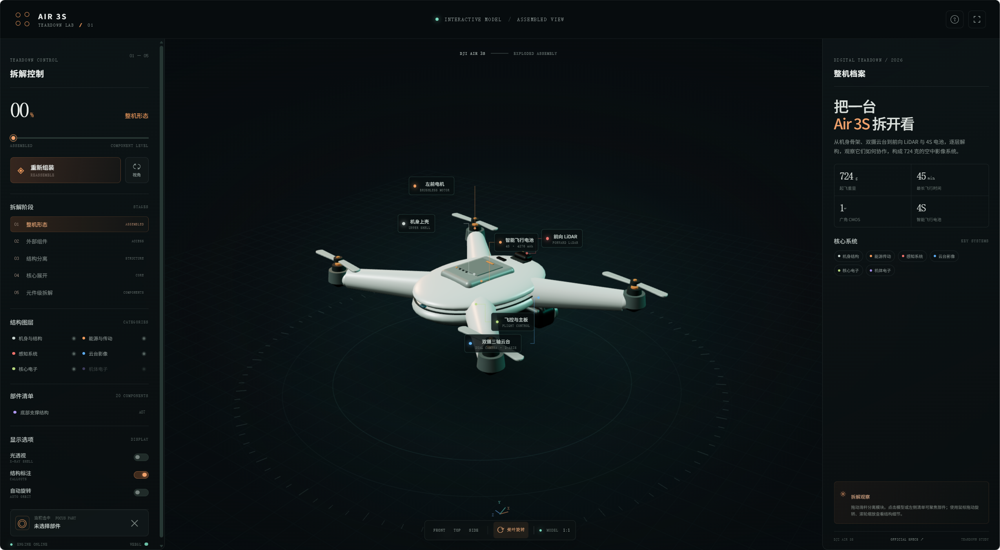
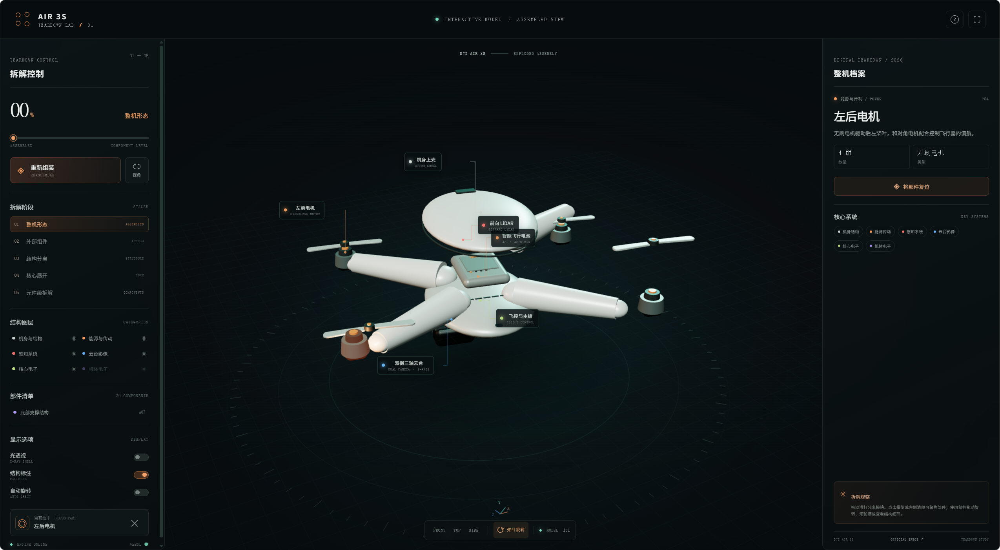

# DJI Air 3S Teardown

基于 Three.js 的 DJI Air 3S 交互式 3D 拆解展示。机体由代码生成，不依赖外部 3D 模型；支持部件拆解、旋转缩放、参数查看，并内嵌循环背景音乐。

| 整机视图 | 拆解视图 |
| --- | --- |
|  |  |

直接打开 `index.html` 即可体验。页面从 jsDelivr 加载 Three.js，因此需要网络连接；浏览器若限制有声自动播放，音乐会在首次交互后开始。